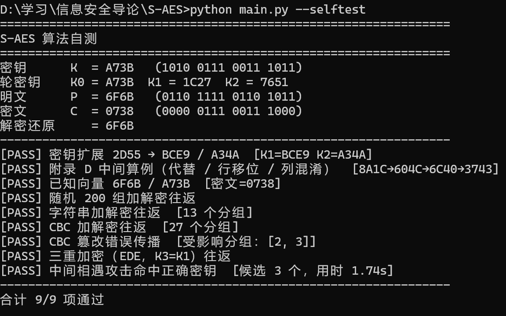
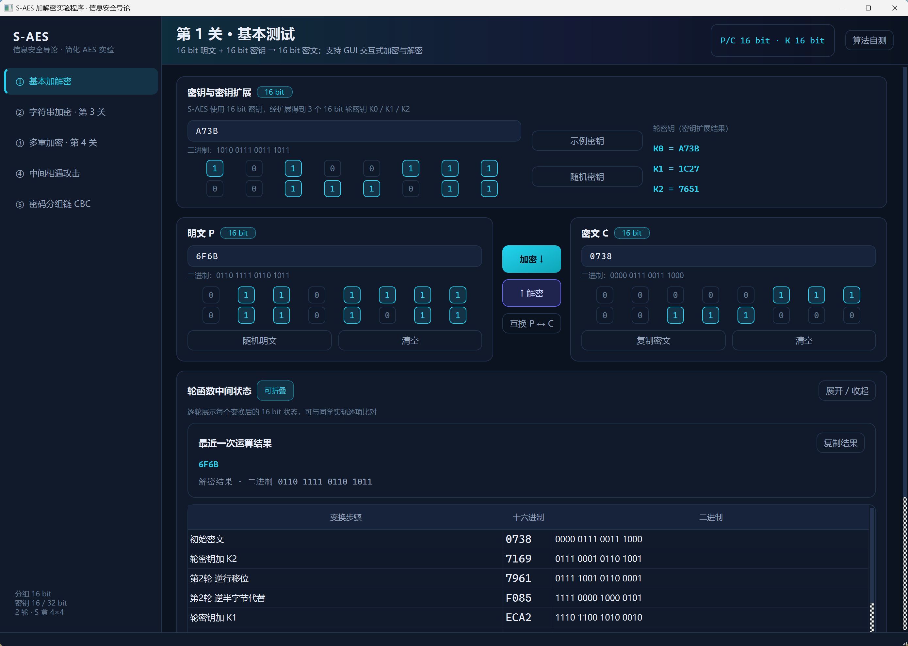
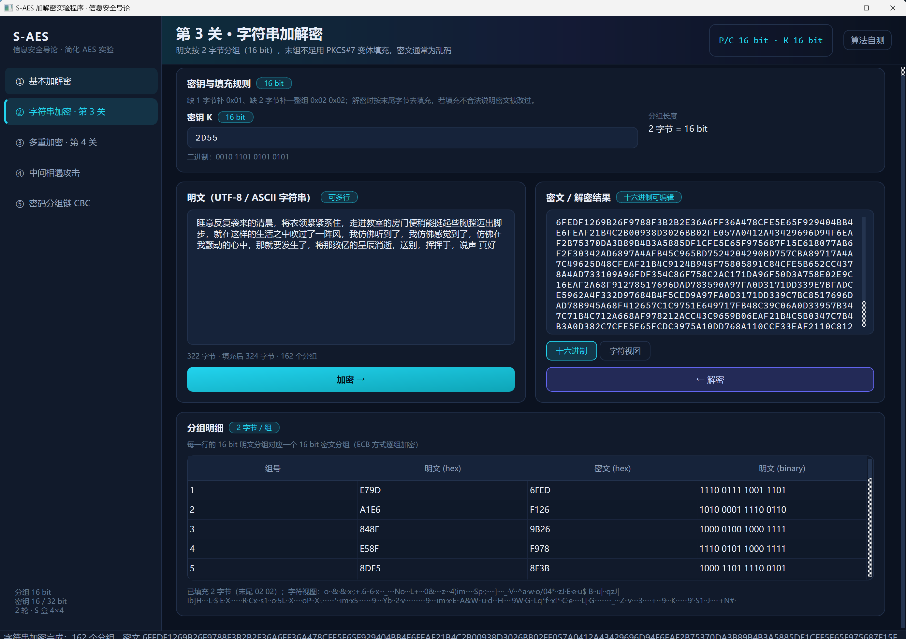
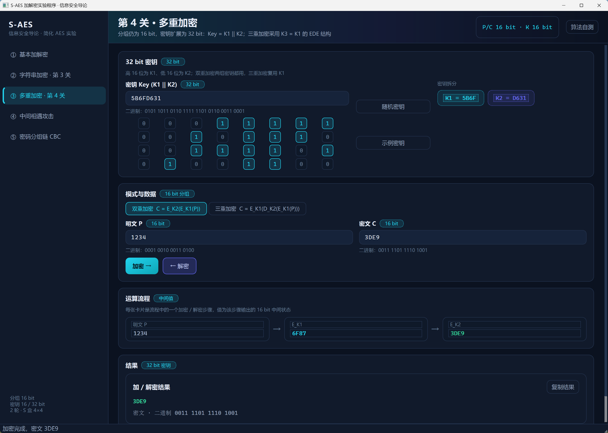
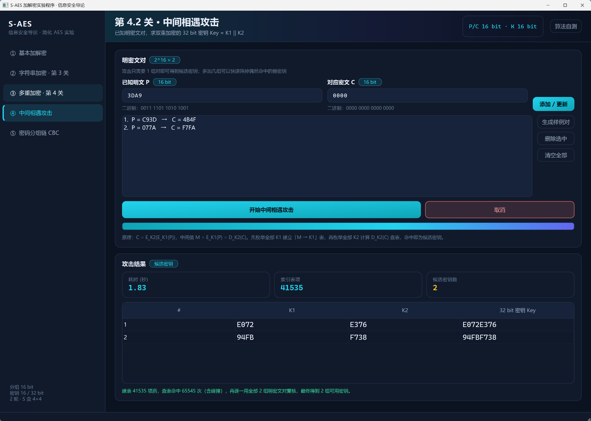
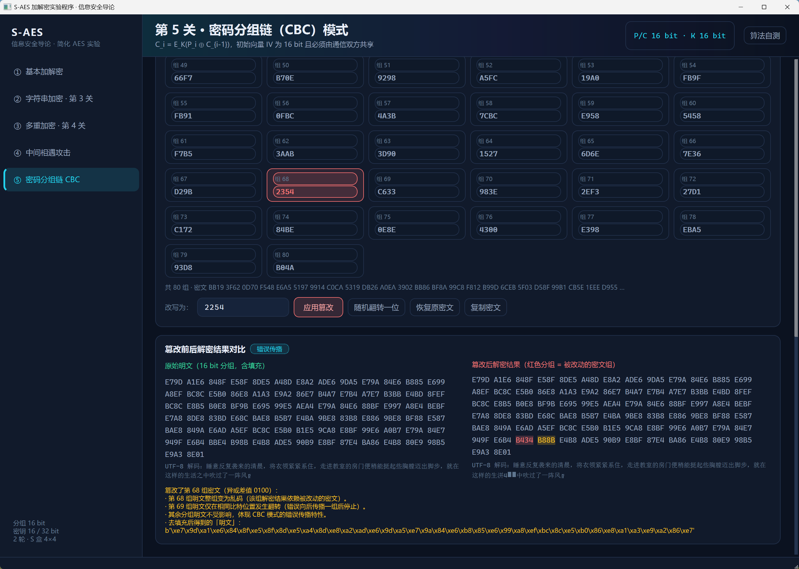

# S-AES 加解密实验程序 · 测试过关报告

> 按五个关卡分别给出测试目标、测试向量、测试方法与结果。
> 自动化测试使用内置算法自测（`python main.py --selftest`）与 GUI 各页面操作验证作为佐证。
> （注：本项目未提交 `tests/` 单元测试部分，相关验证改由“算法自测 + 界面操作”覆盖。）

## 1. 测试环境

| 项目     | 取值                                                       |
| ------ | -------------------------------------------------------- |
| 操作系统   | Windows                                                  |
| Python | 3.11                                                     |
| PyQt5  | 5.15+                                                    |
| 运行命令   | `python main.py --selftest`（算法自测）/ `python main.py`（GUI） |

## 2. 自动化测试结果（算法自测）

### 2.1 算法自测（`python main.py --selftest`）

该命令不依赖 PyQt5，可在无界面环境验证算法，并逐条打印与教材一致的测试结果。

九项自测与五关卡的对应关系：

| 自测项                       | 归属关卡  |
| ------------------------- | ----- |
| 密钥扩展 2D55 → BCE9 / A34A   | 第1/2关 |
| 附录 D 中间算例（代替 / 行移位 / 列混淆） | 第2关   |
| 已知向量 6F6B / A73B          | 第1关   |
| 随机 200 组加解密往返             | 第1关   |
| 字符串加解密往返                  | 第3关   |
| CBC 加解密往返                 | 第5关   |
| CBC 篡改错误传播                | 第5关   |
| 三重加密（EDE，K3=K1）往返         | 第4关   |
| 中间相遇攻击命中正确密钥              | 第4.2关 |

## 3. 按关卡分别报告

### 第 1 关 · 基本加解密 —— 过关 ✅

- **测试目标**：16 bit 明文 / 16 bit 密钥的单分组加解密正确，且能与教材向量一致。

- **测试向量**：
  
  | 用例   | 输入               | 输出           |
  | ---- | ---------------- | ------------ |
  | 完整分组 | `P=6F6B, K=A73B` | `C=0738`     |
  | 完整分组 | `P=0000, K=0000` | `C=071E`     |
  | 边界   | `P=FFFF, K=FFFF` | 解密可还原 `FFFF` |

- **测试结果**：算法自测中“已知向量 6F6B / A73B”与“随机 200 组加解密往返”通过；GUI 页面①手动验证密文 `0738` 正确
  

### 第 2 关 · 交叉测试 —— 过关 ✅

- **测试目标**：S 盒、列混淆矩阵、参考向量与教材 / 同组同学实现完全一致。

- **测试向量**：
  
  | 用例    | 输入            | 输出                          |
  | ----- | ------------- | --------------------------- |
  | 密钥扩展  | `K=2D55`      | `K0=2D55, K1=BCE9, K2=A34A` |
  | 密钥加   | `A479 ⊕ 25D5` | `81AC`                      |
  | 半字节代替 | `8A1C`        | `604C`                      |
  | 行移位   | `604C`        | `6C40`                      |
  | 列混淆   | `6C40`        | `3743`                      |

- **测试结果**：算法自测中“密钥扩展 2D55 → BCE9 / A34A”与“附录 D 中间算例”通过；GUI 页面①底部“交叉测试”面板可见 S 盒、矩阵与参考向量，可一键复制测试向量与他人比对。

### 第 3 关 · 字符串加解密 —— 过关 ✅

- **测试目标**：字符串（含中文）按 2 字节分组加解密后原样还原，填充合法。
- **测试内容**：自测项“字符串加解密往返”使用 `信息安全导论 S-AES` 加密后解密校验原样还原；GUI 页面②额外验证中文串、十六进制 / 字符视图切换。
- **测试结果**：自测通过；GUI 手动加密中文串并切换视图正常。
  

### 第 4 关 · 多重加密与中间相遇攻击 —— 过关 ✅

- **测试目标**：双重 / 三重加密互逆（`K1==K2` 退化为单次）；中间相遇攻击能命中真实密钥。
- **测试内容**：自测项“三重加密（EDE，K3=K1）往返”与“中间相遇攻击命中正确密钥”（候选含真实 `(K1,K2)`）；GUI 页面③展示双/三重运算流程，页面④执行攻击并列出候选密钥。
- **测试结果**：自测通过；GUI 页面③/④手动运行确认。
  

  

### 第 5 关 · CBC 工作模式 —— 过关 ✅

- **测试目标**：CBC 加解密往返；篡改某分组后错误仅传播到下一分组；IV 错误只影响第一组。
- **测试内容**：自测项“CBC 加解密往返”与“CBC 篡改错误传播”（被改组整组乱码、下一分组仅翻转位、其余不受影响）。
- **测试结果**：自测通过；GUI 页面⑤展示 IV、分组卡片与“原始明文 vs 篡改后解密”红/黄对比。
  

## 4. 结论

五个关卡功能均按教材附录 D 实现，并通过算法自测（9/9）与界面操作验证；交叉测试向量与同组 / 教材实现一致；CBC 错误传播特性与理论相符；中间相遇攻击在 2×2¹⁶ 复杂度下成功恢复真实密钥。**综合判定：通过。**

